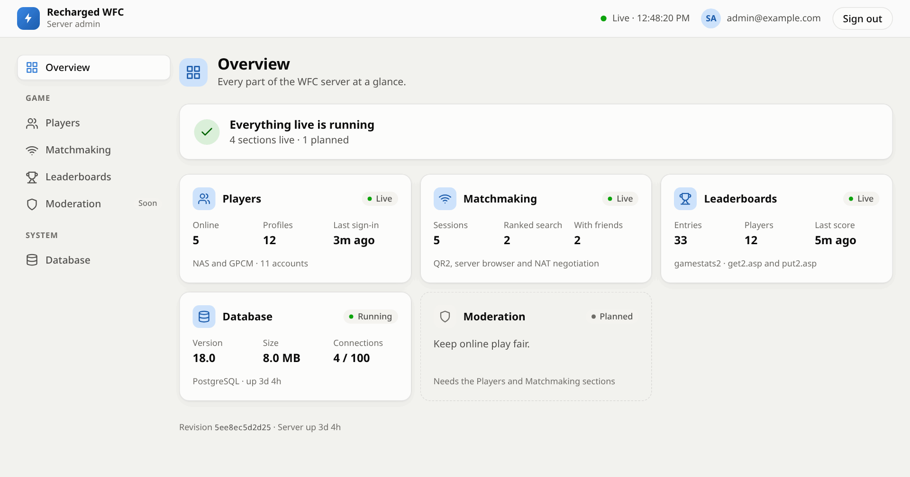
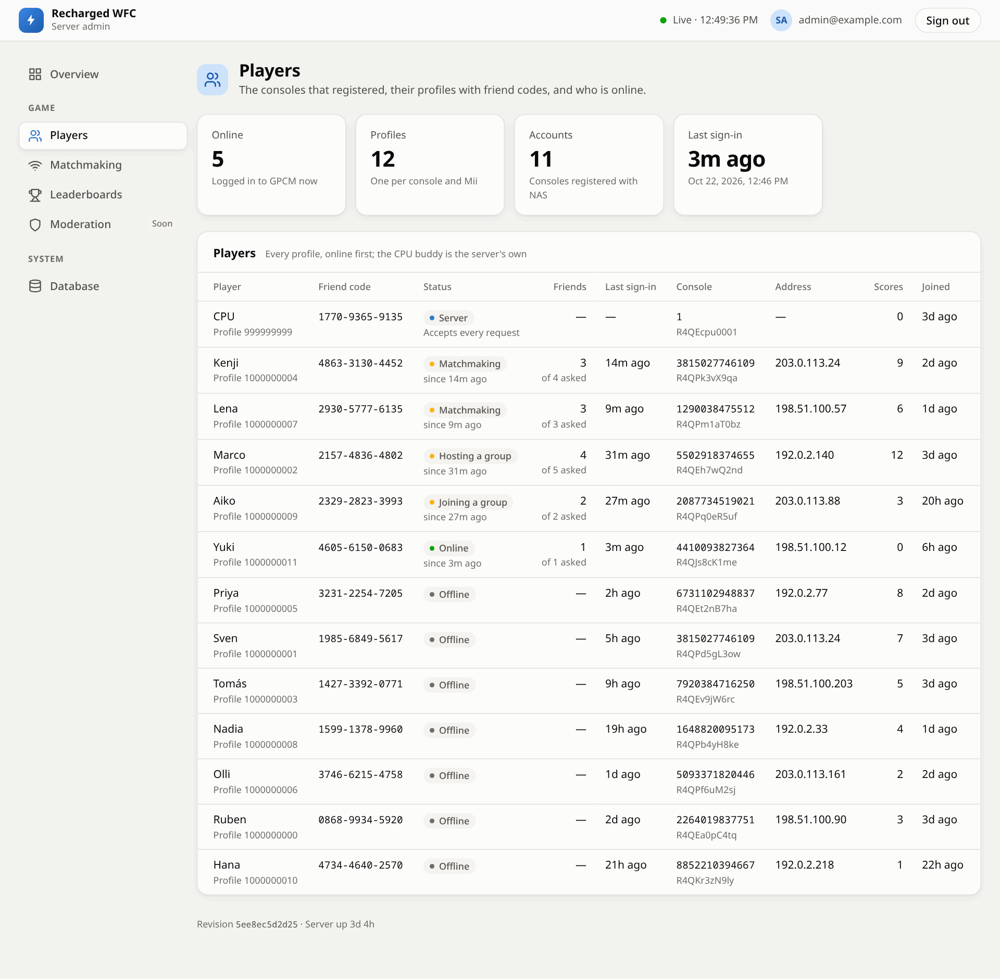
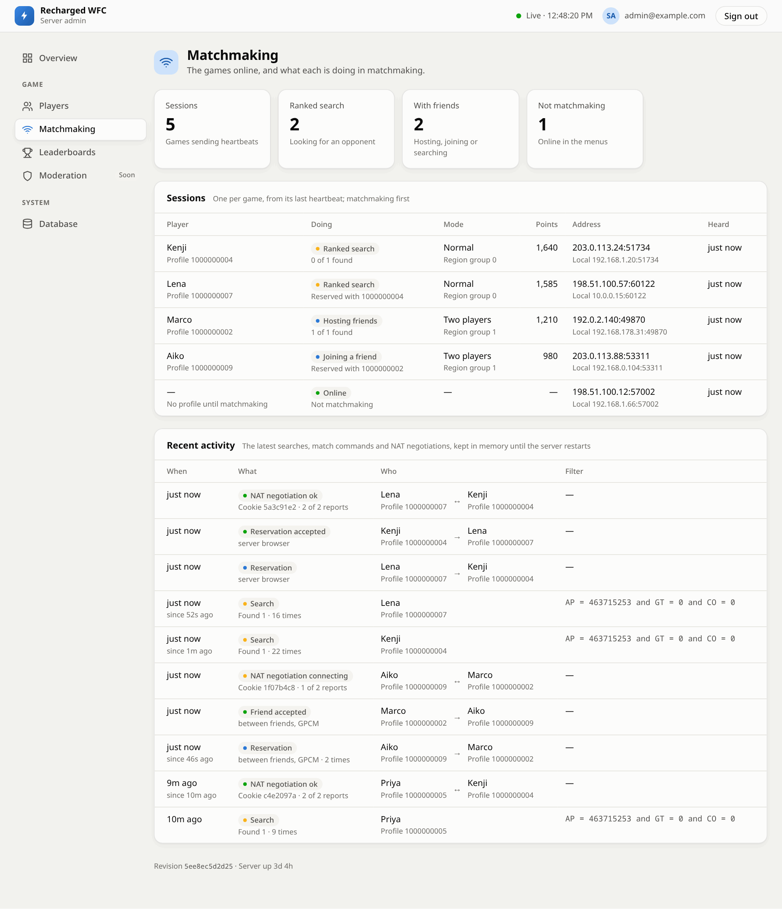
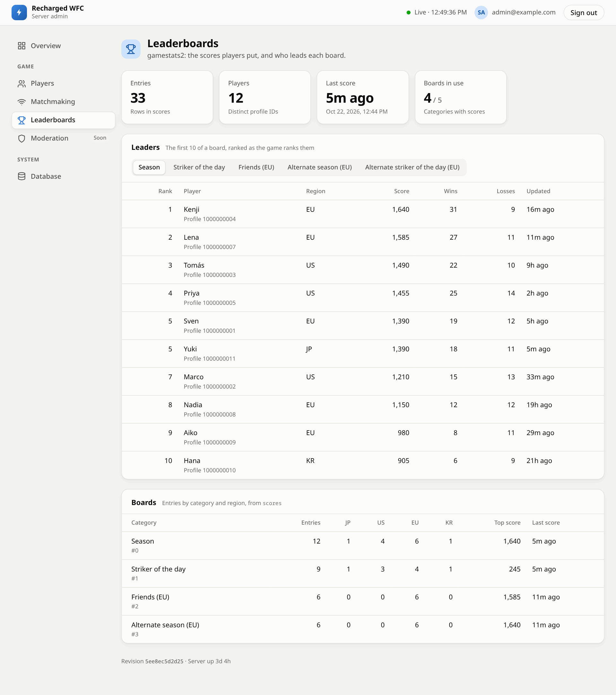
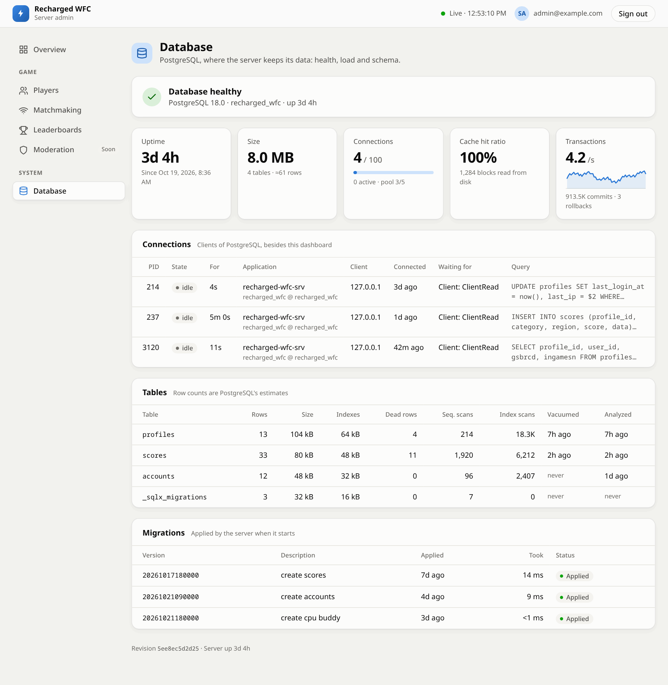

# Recharged WFC

The online server for [**Recharged**](https://github.com/previouslevelgames/recharged),
the native PC port of **Mario Strikers Charged**.

Mario Strikers Charged played online through the Nintendo Wi-Fi Connection
(WFC), which Nintendo shut down in 2014. This server brings those online modes
back for Recharged: going online with your Mii, friends, friend battles, ranked
matches and the leaderboards. It is written in Rust, with
[WiiLink's wfc-server](https://github.com/WiiLink24/wfc-server) as its
reference, and runs as a single Docker container with its own database.

## What works

- **Going online.** The first time a console connects, the server registers it.
  Each Mii gets its own profile and friend code.
- **Friends.** Add each other by friend code. Once both have added each other,
  you see when your friends are online and what they are doing. Removing a
  friend works too. The server has a friend of its own, **CPU**, who accepts
  every request: friend code `1770-9365-9135` (US) or `0009-9999-9999` (EU).
- **Friend battles.** Host a match and invite a friend, or join one.
- **Ranked matches.** **RANKED** in WFC Central pairs players who search at the
  same time, and helps the two games reach each other through home routers.
- **Leaderboards.** Ranked results count towards the season and *Striker of the
  day* boards, plus the boards only the European release has. A score is only
  accepted from the player who is signed in. As in the original game, seasons
  restart every week; the dashboard keeps how the last one ended.
- **Admin dashboard.** A web page for whoever runs the server, see below.

Not there yet: moderation tools (banning a player, kicking one from a match,
removing a score). The server is made for Recharged; real Wii consoles are not
supported.

## Admin dashboard

Whoever runs the server can sign in at `/admin` with a Google account and watch
it live: who is online, who is searching for a match, the leaderboards, the
health of the database and the server's logs. The page follows your system's
light or dark mode.

<p align="center">
  <a href="docs/screenshots/admin-overview-light.png"><picture>
    <source media="(prefers-color-scheme: dark)" srcset="docs/screenshots/admin-overview-dark.png">
    
  </picture></a>
</p>

<table>
<tr>
<td width="50%">
  <a href="docs/screenshots/admin-players-light.png"><picture>
    <source media="(prefers-color-scheme: dark)" srcset="docs/screenshots/admin-players-dark.png">
    
  </picture></a>
  <p align="center"><b>Players</b>: every Mii with its friend code, who is online and what they are doing</p>
</td>
<td width="50%">
  <a href="docs/screenshots/admin-matchmaking-light.png"><picture>
    <source media="(prefers-color-scheme: dark)" srcset="docs/screenshots/admin-matchmaking-dark.png">
    
  </picture></a>
  <p align="center"><b>Matchmaking</b>: who is searching, hosting or joining, and how their matches came together</p>
</td>
</tr>
<tr>
<td width="50%">
  <a href="docs/screenshots/admin-leaderboards-light.png"><picture>
    <source media="(prefers-color-scheme: dark)" srcset="docs/screenshots/admin-leaderboards-dark.png">
    
  </picture></a>
  <p align="center"><b>Leaderboards</b>: the top 10 of every board, with wins and losses</p>
</td>
<td width="50%">
  <a href="docs/screenshots/admin-database-light.png"><picture>
    <source media="(prefers-color-scheme: dark)" srcset="docs/screenshots/admin-database-dark.png">
    
  </picture></a>
  <p align="center"><b>Database</b>: health, load, tables and schema updates</p>
</td>
</tr>
</table>

<sub>The screenshots show made-up players and addresses.</sub>

## Running a server

The server ships as one container image,
`ghcr.io/previouslevelgames/recharged-wfc-srv`, with its PostgreSQL database
inside. It needs five ports reachable from the players' games, and the game is
pointed at it with one line in its `recharged.ini`:

```ini
[online]
server = 203.0.113.10
```

**[docs/install.md](docs/install.md)** walks through the setup on Unraid or
with Docker Compose, the settings, the admin dashboard's Google sign-in and
updates.

## More

- [docs/install.md](docs/install.md): installing, configuring and updating the server
- [docs/development.md](docs/development.md): building and testing it, and how releases work
- [docs/login.md](docs/login.md) and [docs/gamestats2.md](docs/gamestats2.md):
  what the game sends and what the server answers, for going online and for the leaderboards
- [docs/profiles.md](docs/profiles.md): Recharged profiles, which the launcher signs in to for competitive play
