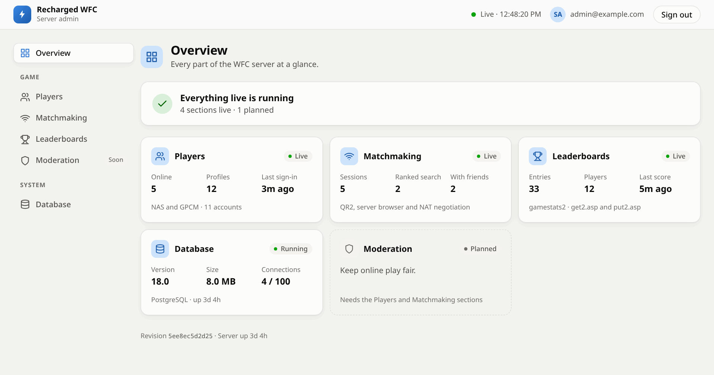

# Recharged WFC

The online server for [**Recharged**](https://github.com/previouslevelgames/recharged),
the native PC port of **Mario Strikers Charged**.

The game played online through the Nintendo Wi-Fi Connection (WFC), which
Nintendo shut down in 2014. This server brings those online modes back for
Recharged. It is written in Rust, with
[WiiLink's wfc-server](https://github.com/WiiLink24/wfc-server) as its
reference, and runs as one Docker container with its own database.

## What works

- **Going online** with your Mii. Each Mii gets its own profile and friend code.
- **Friends.** Add each other by friend code and see who is online. The
  server's own friend, **CPU**, accepts every request: `1770-9365-9135` (US) or
  `0009-9999-9999` (EU).
- **Friend battles and ranked matches.** Invite a friend, or search in
  **RANKED** in WFC Central.
- **Relay.** When two games cannot reach each other (error 86070), the server
  can pass the match on between them.
- **Leaderboards.** The season and *Striker of the day* boards, plus the
  European release's own. Seasons restart every week, as in the original game.
- **Competitive play.** Players sign in from the Recharged launcher to play
  sets by the server's rules.
- **Match reports.** Both games report every series they play online; the
  server pairs the reports into one match.
- **Admin dashboard** for whoever runs the server, see below.

Not there yet: more moderation, such as kicking a player from a match. The
server is made for Recharged; real Wii consoles are not supported.

## Disclaimer: AI assistance

Recharged WFC is built with AI assistance. We want to be clear about how, and
where we stand.

We see AI as a power tool. Like a chainsaw, it is dangerous in careless hands
and a huge multiplier in trained ones. This is a passion project, and AI does
not change that: it lets a small team take on a project of this size and spend
its care where it matters, on bringing the online modes of Mario Strikers
Charged back.

What AI cannot change is the protocol. The server has to answer exactly what
the original game expects, with
[WiiLink's wfc-server](https://github.com/WiiLink24/wfc-server) as our
reference. The real game is the final judge of every answer.

How we use it:

- **Code.** The server (accounts, friends, matchmaking, the relay and the
  leaderboards) is mostly crafted by hand. AI coding agents assist along the
  way, for example with refactoring, tests and repetitive changes. They speed
  up the work; they don't make the decisions. Design and architecture are ours,
  every change is reviewed, and nothing ships until it passes formatting, lint
  and tests and has been tried against the real game on a test server.
- **Admin dashboard.** Our focus is the server: protocols, architecture, data
  and operations. Most of the dashboard's HTML, CSS and JavaScript was built
  with AI assistance, so our own time goes into the system behind it. Frontend
  and design contributions are very welcome:
  [open an issue](https://github.com/previouslevelgames/recharged-wfc-srv/issues).
- **Debugging and analysis.** AI helps us read server logs faster and analyse
  packet captures and protocol dumps in depth.
- **Documentation.** English is not our first language. Much of the
  documentation is corrected or rewritten with LLMs, from our notes and the code.

The responsibility stays with us. Every bug in Recharged WFC is ours, not the
tool's. And there will be bugs.

We know AI is a contested topic. If you would rather not use software built
this way, we respect that. If you enjoy playing online again, or want to
contribute, you are very welcome.

## Admin dashboard

Sign in at `/admin` with a Google account to watch the server live: players
online, matchmaking, matches, leaderboards, the database and the logs.

<p align="center">
  <a href="docs/screenshots/admin-overview-light.png"><picture>
    <source media="(prefers-color-scheme: dark)" srcset="docs/screenshots/admin-overview-dark.png">
    
  </picture></a>
</p>

More pages: [players](docs/screenshots/admin-players-light.png),
[matchmaking](docs/screenshots/admin-matchmaking-light.png),
[leaderboards](docs/screenshots/admin-leaderboards-light.png),
[database](docs/screenshots/admin-database-light.png). The screenshots show
made-up players and addresses.

## Running a server

The image is `ghcr.io/previouslevelgames/recharged-wfc-srv`, with PostgreSQL
inside; several servers can also share one database container. Open five ports
to the players' games, then point the game at the server in its
`recharged.ini`:

```ini
[online]
server = 203.0.113.10
```

[docs/install.md](docs/install.md) covers Unraid and Docker Compose, the
settings, the dashboard's Google sign-in and updates.

## Documentation

- [install.md](docs/install.md): installing, configuring and updating the server
- [development.md](docs/development.md): building, testing and releases
- [login.md](docs/login.md) and [gamestats2.md](docs/gamestats2.md): what the
  game sends and the server answers, for going online and the leaderboards
- [reports.md](docs/reports.md): match reports, and how they pair into matches
- [profiles.md](docs/profiles.md): Recharged profiles for competitive play
- [CONTRIBUTING.md](CONTRIBUTING.md): reporting problems, ideas and pull requests
